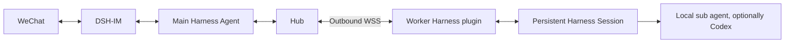

# Agent Hub for DeepSeek Harness

[简体中文](README.md) | English

WeChat orchestration and persistent-session tasks across multiple devices. A main Agent dispatches work to each device's DeepSeek Harness Session. Results are stored durably; the plugin sends completion notices directly to WeChat, and the main Agent can provide detailed follow-up reports.



- One Harness plugin with Hub and worker roles; starts and stops with Harness.
- Settings page for pairing codes, device status, communication checks, Session binding and unpairing.
- Serial execution per Session and concurrent execution across devices, with durable receipts and reconnect reconciliation.
- Separate records for result receipt, main-Agent consumption and WeChat delivery; a busy main Session cannot block completion notices.
- Device-local models, credentials and permissions. Optional Codex work is delegated by that device's Harness through a local sub agent.

## Quick start

The first verified combination is **Windows, Harness 0.2.1-rc.2 desktop profile and Node 24.21.0**. Harness needs bundled Node 24+ and compatible native Session, tools and approval services. The Hub also requires DSH-IM with WeChat Session synchronization enabled. Verify compatibility before adopting another Harness release.

With the native `dsh` CLI installed:

```sh
dsh plugin --profile desktop add github:810535323/dsh-agent-hub
```

Reopen Harness and go to **Settings → Agent Hub devices** (currently labeled **设置 → Agent Hub 设备**). A source installation starts in setup mode; choose its role on the page.

1. On the Hub, configure the listener, port and TLS files. Bind the main Session associated with a synchronized WeChat target, then generate a one-time pairing code.
2. On a worker, enter `https://YOUR_PUBLIC_IP:PORT`, the code, a device name and a working directory. Pair and connect. Supply the public CA certificate when using a private CA.
3. Check that the device is online and its persistent Session is ready. Ask the main Agent through WeChat to list devices and dispatch work.

Direct IP connections use HTTPS/WSS without a domain; the certificate SAN must match the IP. Public packages contain no operator address, certificates or credentials. See [installation](docs/INSTALL.en.md) for the Windows desktop installer, source installation and unpairing.

## Tasks and notifications

The main Agent uses `agent_hub_devices`, `agent_hub_dispatch`, `agent_hub_task` and `agent_hub_cancel`. Dispatch returns a task ID immediately and rejects offline devices. A dedicated Session is created once, reused across tasks and restarts, and replaced only after confirmed absence.

When results arrive, the plugin sends a WeChat completion notice independently of the current main-Agent turn. Unread results remain visible on the settings page. The main Agent reads them with `agent_hub_pending_reports`, then acknowledges the exact revision with `agent_hub_ack_reports`. Ambiguous WeChat delivery remains pending investigation and is not blindly resent.

`completed` means the native turn ended; evidence determines whether the user's goal was achieved. Results contain the final answer, status, verification summary, exit codes and device-local artifact references. The protocol does not automatically synchronize full conversations, reasoning or raw command output, and does not upload files. Prompts and final answers can still contain information intentionally supplied by users.

## Documentation and development

- [Installation, pairing and unpairing](docs/INSTALL.en.md)
- [Architecture, recovery and privacy](docs/ARCHITECTURE.en.md)
- [Deployment and migration](docs/DEPLOY.en.md)
- [Contributing and DSH conventions](CONTRIBUTING.md) · [Security reports](SECURITY.md)

```sh
pnpm install --frozen-lockfile
pnpm run check
pnpm run check:public
pnpm test
```

Tests require OpenSSL 1.1.1+. On Windows, Git for Windows' OpenSSL is detected automatically; override it with `AGENT_HUB_OPENSSL`. Optional native and browser smoke tests use isolated profiles without model inference or real WeChat messages. CI runs unit and protocol tests on Windows and Linux; Linux desktop installation is not yet verified.

The plugin name is always `dsh-agent-hub`; the installer archive is `agent-hub-harness.zip`. User-facing releases use **latest**, while internal semantic and protocol versions support package management and compatibility. [MIT licensed](LICENSE). This is an independent community plugin, not an official DeepSeek product.
