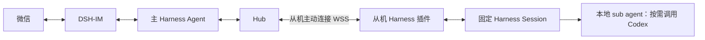

# Agent Hub for DeepSeek Harness

简体中文 | [English](README.en.md)

微信主控与多设备固定会话任务插件。主 Agent 派发任务，各设备的 DeepSeek Harness 在固定 Session 中执行；结果持久保存，插件独立通知微信，主 Agent 按需整理详细结论。



- 一个 Harness 插件，提供主机、从机两种角色；随 Harness 开启和退出。
- 设置页面生成配对码、查看设备、检查通信、绑定 Session 和解绑。
- 同一会话串行、不同设备并行；断线后对账，持久回执确认后才停止重传。
- 执行结果、主 Agent 阅读确认、微信投递分别保存；忙碌的主会话不会阻塞完成通知。
- 从机保留自己的模型、凭据和权限；需要 Codex 时由对应机器的 Harness 通过 sub agent 调用。

## 快速开始

首个验证组合为 **Windows、Harness 0.2.1-rc.2 desktop profile、Node 24.21.0**。需要 Harness 内置 Node 24+、原生 Session/工具/审批接口；主机还需安装并启用 DSH-IM 的微信会话同步。其他 Harness 版本需先验证接口兼容性。

在安装了 `dsh` CLI 的机器上，可用原生插件管理器安装公开仓库：

```sh
dsh plugin --profile desktop add github:810535323/dsh-agent-hub
```

重新打开 Harness，进入 **设置 → Agent Hub 设备**。源码安装默认为待配置状态，在页面选择角色。

1. 主机选择主机角色，配置监听地址、端口和 TLS 文件，绑定微信同步目标对应的主 Session，再生成一次性配对码。
2. 从机选择从机角色，填写 `https://你的公网IP:端口`、配对码、设备名称和项目目录，点击“绑定并自动连接”。私有 CA 需要额外提供公开 CA 证书。
3. 检查设备在线、通信正常、固定 Session 就绪后，通过微信让主 Agent 查询设备并派发任务。

IP 直连支持 HTTPS/WSS，不需要域名；证书 SAN 必须匹配该 IP。公开包不预置运营主机、证书或凭据。Windows 桌面安装器、源码安装和解绑见[安装指南](docs/INSTALL.md)。

## 任务与通知

主 Agent 使用 `agent_hub_devices`、`agent_hub_dispatch`、`agent_hub_task`、`agent_hub_cancel`。派发立即返回任务编号，离线设备直接拒绝。固定会话首次创建，后续任务和重启复用；仅明确不存在时重建。

任务结果到达后，插件直接向绑定微信发送结束通知，不等待主会话当前轮次。未读结果保留在“待处理任务结果”中。主 Agent 调用 `agent_hub_pending_reports` 读取，再以 `agent_hub_ack_reports` 确认对应修订号。微信发送结果不明时显示待核查，不自动重发。

`completed` 表示原生轮次结束，业务目标是否达成仍需核查证据。任务只回传最终答复、状态、验证摘要、退出码和设备上的产物引用；不自动传输完整对话、思考或原始命令输出，不自动上传文件。任务提示与最终答复仍可能包含用户主动提供的信息。

## 文档与开发

- [安装、配对与解绑](docs/INSTALL.md) · [Installation](docs/INSTALL.en.md)
- [架构、恢复与隐私](docs/ARCHITECTURE.md) · [Architecture](docs/ARCHITECTURE.en.md)
- [部署与迁移](docs/DEPLOY.md) · [Deployment](docs/DEPLOY.en.md)
- [开发与 DSH 插件规范](CONTRIBUTING.md) · [安全报告](SECURITY.md)

```sh
pnpm install --frozen-lockfile
pnpm run check
pnpm run check:public
pnpm test
```

测试需要 OpenSSL 1.1.1+；Windows 可使用 Git for Windows 自带的 OpenSSL，或设置 `AGENT_HUB_OPENSSL`。真实 Harness 和页面检查使用隔离配置，不调用真实模型或微信，详见开发指南。CI 在 Windows 和 Linux 运行单元与协议测试；这不代表已验证 Linux 桌面安装器。

插件名固定为 `dsh-agent-hub`，安装包固定为 `agent-hub-harness.zip`，发布名称统一为“最新版本”。内部语义版本与通信协议版本用于包管理和兼容性。采用 [MIT License](LICENSE)。本项目是第三方插件，不是 DeepSeek 官方产品。
